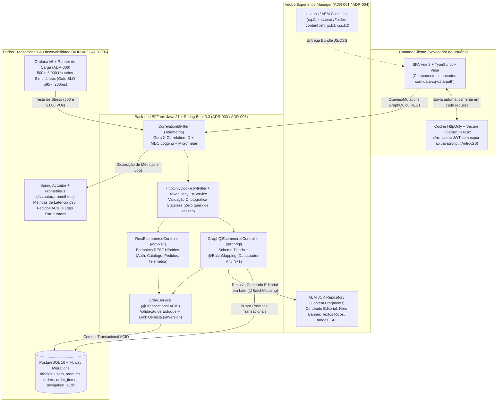
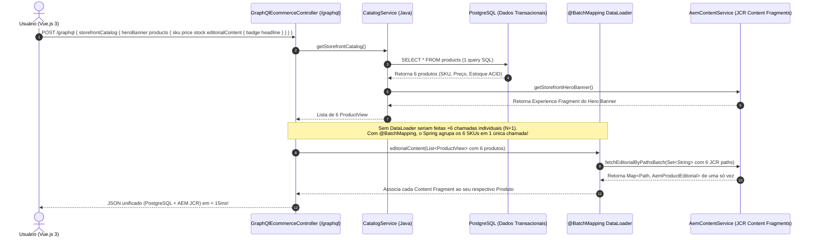
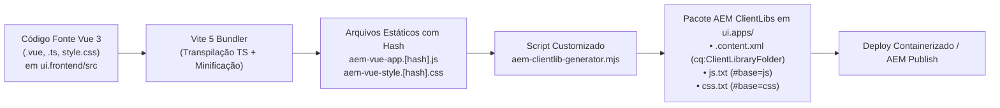

# Fluxograma da Aplicação — Apresentação para Entrevista com o Gestor

Este documento reúne os fluxogramas arquiteturais e de sequência da aplicação **QuantumStore E-Commerce**, projetados especificamente para apresentação técnica durante a entrevista com o gestor.

---

## 1. Visão Macro da Arquitetura (Ecossistema Containerizado — ADR-001 a ADR-006)



---

## 2. Fluxo de Agregação GraphQL BFF + Solução do Problema de N+1 Queries (ADR-003)

O diagrama abaixo mostra como uma **única requisição GraphQL** do Vue.js traz dados combinados do **PostgreSQL** e do **AEM**, e como o `@BatchMapping` (**DataLoader**) evita que 6 produtos gerem 6 chamadas separadas ao AEM:



---

## 3. Fluxo de Autenticação Stateless OAuth 2.0 + JWT em Cookie HttpOnly & Deny List (ADR-005)

```mermaid
sequenceDiagram
    autonumber
    actor Browser as Navegador (Vue.js)
    participant Auth as AuthController (/api/v1/auth)
    participant Filter as HttpOnlyCookieJwtFilter
    participant DenyList as TokenDenyListService (Cache/Memória)
    participant Jwt as JwtService (Assinatura HMAC-SHA256)
    participant PG as PostgreSQL (Tabela users)

    rect rgb(15, 35, 60)
        Note over Browser,PG: 1. Processo de Login (Consulta o banco apenas 1 vez)
        Browser->>Auth: POST /api/v1/auth/login (email + senha)
        Auth->>PG: findByEmailIgnoreCase(email)
        PG-->>Auth: UserEntity (hash BCrypt)
        Auth->>Auth: passwordEncoder.matches(senha, hash)
        Auth->>Jwt: generateToken(user) -> inclui jti, sub, role, planTier
        Auth-->>Browser: HTTP 200 + Header Set-Cookie: ACCESS_TOKEN=<jwt>; HttpOnly; SameSite=Lax
    end

    rect rgb(15, 50, 40)
        Note over Browser,PG: 2. Requisições Subsequentes ao GraphQL/REST (100% Stateless - Zero consulta ao Banco!)
        Browser->>Filter: POST /graphql (Cookie: ACCESS_TOKEN=<jwt> enviado automaticamente)
        Filter->>Jwt: parseAndValidateClaims(jwt) (Validação criptográfica em memória)
        Filter->>DenyList: isRevoked(jti)?
        DenyList-->>Filter: false (Token ativo)
        Filter->>Filter: Popula SecurityContextHolder com AuthenticatedUserPrincipal
        Filter-->>Browser: Executa Mutation createOrder autenticada!
    end

    rect rgb(60, 20, 30)
        Note over Browser,PG: 3. Logout Seguro com Revogação Imediata na Deny List
        Browser->>Auth: POST /api/v1/auth/logout
        Auth->>DenyList: revokeToken(jti, expirationInstant)
        Auth-->>Browser: Set-Cookie: ACCESS_TOKEN=""; Max-Age=0
    end
```

---

## 4. Pipeline de Build do Front-end Vue.js para AEM ClientLibs (ADR-004)



