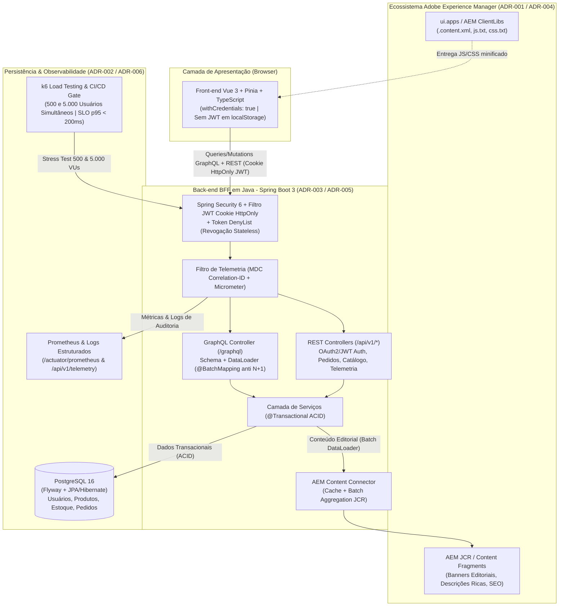

# Plano de Desenvolvimento — E-Commerce Enterprise (Vue.js + AEM + Java Spring Boot + GraphQL + PostgreSQL)

## 1. Objetivo Executivo
Desenvolver uma aplicação de **E-Commerce Enterprise** completa, containerizada e pronta para apresentação técnica em entrevista com gestor, atendendo integralmente aos requisitos descritos em `docs/introducao.md` e às decisões arquiteturais documentadas nas ADRs (`ADR-001` a `ADR-006`).

---

## 2. Mapeamento de Requisitos & ADRs (`ADR-001` a `ADR-006`)

| Requisito / ADR | Solução Técnica Implementada |
| :--- | :--- |
| **ADR-001: Containerização do Ecossistema com Docker** | **Docker & Docker Compose** orquestrando: **PostgreSQL 16**, **AEM Headless/JCR Mock** (simulando Author/Publish & Content Fragments), **Back-end Java (Spring Boot 3)**, **Front-end Vue 3 / Nginx (ClientLibs)** e **Prometheus** para observabilidade. |
| **ADR-002: Banco de Dados Relacional (PostgreSQL) Transacional** | **PostgreSQL 16** gerenciado via **Spring Data JPA / Hibernate** e versionado com **Flyway** (`V1__init_schema.sql`, `V2__seed_data.sql`), garantindo propriedades **ACID** (`@Transactional`) em operações financeiras/pedidos, controle de concorrência otimista (`@Version`) e separação clara entre **Conteúdo Editorial (AEM JCR)** e **Dado Transacional (PostgreSQL)**. |
| **ADR-003: GraphQL como Camada de API (BFF) + DataLoader** | **Java 21/22 + Spring Boot 3.3**, expondo camada BFF em **Spring for GraphQL** (`/graphql`) + **API REST** (`/api/v1/*`). Implementa **`@BatchMapping` (DataLoader)** para eliminar o problema de **N+1 queries** ao agregar dados transacionais do PostgreSQL com conteúdos editoriais vindos do AEM. |
| **ADR-004: Pipeline de Build do Front-end (Vue.js no AEM)** | Aplicação **Vue 3 + TypeScript + Vite + Pinia** com script de build automatizado (`ui.frontend/scripts/aem-clientlib-generator.mjs`) que transpila, minifica e mapeia os arquivos gerados com hash pelo Vite para a estrutura de pacotes do **AEM ClientLibs** (`ui.apps/src/main/content/jcr_root/apps/ecommerce/clientlibs/clientlib-site/.content.xml`, `js.txt` e `css.txt`). |
| **ADR-005: Autenticação Stateless (OAuth 2.0 + JWT em Cookies HttpOnly)** | **Spring Security 6 + OAuth2/JWT Stateless**. No login, o servidor emite um token JWT assinado contendo claims de identidade e roles, entregue via **Cookie `HttpOnly`, `Secure` e `SameSite=Lax`** (nunca salvo em `localStorage`, prevenindo ataques XSS). Validação criptográfica stateless sem consultar o PostgreSQL a cada request + **Token Deny List em memória** para revogação imediata no logout. |
| **ADR-006: Testes de Carga e Stress Contínuos na Esteira (CI/CD)** | Scripts **Grafana k6** (`load-tests/k6-ecommerce-load.js`) + executor assíncrono de alta concorrência (`load-tests/run-load-test.mjs`) simulando a jornada completa (**AEM Home -> Catálogo GraphQL -> Carrinho/Pedido**) para **500 e 5.000 usuários simultâneos**, validando o SLO de **`p(95) < 200ms`** e integrados à pipeline de CI/CD (`.github/workflows/ci-cd.yml`). |
| **Telemetria & Monitoramento de Logs** | Filtro de **Correlation ID (`X-Correlation-ID`)** propagado via **MDC (Mapped Diagnostic Context)** em logs estruturados JSON/console, métricas **Micrometer + Prometheus** (`/actuator/prometheus`), e endpoint/painel de observabilidade em tempo real (`/api/v1/telemetry`). |
| **Testes Unitários e End-to-End (E2E)** | **Unitários Back-end**: JUnit 5 + Mockito + Spring Boot Test (Auth JWT HttpOnly, DataLoader GraphQL, Transações ACID, Token DenyList).<br>**Unitários Front-end**: Vitest + Vue Test Utils.<br>**End-to-End (E2E)**: Playwright testando a jornada completa do usuário. |
| **Git, Fluxograma e Guia para Entrevista** | Versionamento Git com commits semânticos, documentação com **Fluxogramas Mermaid** (`docs/FLUXOGRAMA_ARQUITETURA.md`) e **Guia Completo de Entendimento do Código para a Entrevista** (`docs/GUIA_ENTREVISTA_ENTENDIMENTO_CODIGO.md`). |

---

## 3. Fluxograma Arquitetural da Aplicação



---

## 4. Estrutura de Diretórios do Projeto

```text
ecommerce-project/
├── .github/workflows/
│   └── ci-cd.yml                     # Pipeline CI/CD com Build, Testes, ClientLibs AEM e Gate k6 (ADR-006)
├── docs/
│   ├── introducao.md
│   ├── ADRS/
│   │   └── ADR001.md .. ADR006.md
│   ├── PLANS/
│   │   └── PLANO_DESENVOLVIMENTO.md
│   ├── FLUXOGRAMA_ARQUITETURA.md
│   └── GUIA_ENTREVISTA_ENTENDIMENTO_CODIGO.md
├── backend/                          # Back-end Java (Spring Boot 3 + GraphQL + REST + JPA + Security + Actuator)
│   ├── Dockerfile
│   ├── mvnw / mvnw.cmd
│   ├── pom.xml
│   └── src/
│       ├── main/
│       │   ├── java/com/ecommerce/
│       │   │   ├── config/           # SecurityConfig, GraphQlConfig, CacheConfig
│       │   │   ├── controller/       # GraphQlEcommerceController, RestEcommerceController, AuthController, TelemetryController
│       │   │   ├── domain/           # Entidades JPA (UserEntity, ProductEntity, OrderEntity, OrderItemEntity, NavigationAuditEntity)
│       │   │   ├── dto/              # Records de Request/Response, Modelos AEM JCR e Eventos de Telemetria
│       │   │   ├── repository/       # Spring Data JPA Repositories
│       │   │   ├── security/         # JwtService, HttpOnlyCookieJwtFilter, TokenDenyListService, RateLimitFilter
│       │   │   ├── service/          # CatalogService, OrderService, AemContentService, TelemetryService
│       │   │   └── telemetry/        # CorrelationIdFilter
│       │   └── resources/
│       │       ├── application.yml
│       │       ├── application-docker.yml
│       │       ├── db/migration/     # Flyway SQL Migrations (V1__init_schema.sql, V2__seed_data.sql)
│       │       └── graphql/          # schema.graphqls
│       └── test/                     # Testes Unitários e de Integração (JUnit 5 + Mockito + MockMvc)
├── ui.frontend/                      # Aplicação Front-end em Vue 3 + Vite + TypeScript + Vitest + Playwright
│   ├── Dockerfile
│   ├── nginx.conf
│   ├── package.json
│   ├── vite.config.ts
│   ├── playwright.config.ts
│   ├── scripts/
│   │   └── aem-clientlib-generator.mjs  # ADR-004: Empacota build do Vite em AEM ClientLibs XML
│   ├── src/
│   │   ├── api/                      # Cliente GraphQL + REST (credentials: 'include' para Cookie HttpOnly)
│   │   ├── components/               # Componentes AEM + E-commerce (AemHeroBanner, ProductCatalog, CartDrawer, TelemetryDashboard)
│   │   ├── stores/                   # Pinia Stores (auth, catalog, cart, telemetry)
│   │   └── App.vue
│   └── tests/
│       ├── unit/                     # Testes Unitários Vitest
│       └── e2e/                      # Testes End-to-End Playwright
├── ui.apps/                          # Pacote AEM ClientLibs gerado pelo build (ADR-004)
│   └── src/main/content/jcr_root/apps/ecommerce/clientlibs/clientlib-site/
│       ├── .content.xml
│       ├── css.txt
│       └── js.txt
├── aem-mock/                         # Simulador leve de AEM Author/Publish Content Services (ADR-001)
│   ├── Dockerfile
│   └── server.mjs
├── monitoring/
│   └── prometheus.yml                # Configuração de scrape do Prometheus
├── load-tests/                       # Testes de Carga para 500 e 5.000 usuários simultâneos (ADR-006)
│   ├── k6-ecommerce-load.js          # Script oficial Grafana k6 com SLO p(95) < 200ms
│   ├── run-load-test.mjs             # Executor Node.js de alta concorrência (500 e 5.000 usuários simultâneos)
│   └── RELATORIO_TESTE_CARGA.md      # Resultados reais obtidos nos testes de 500 e 5.000 usuários
└── docker-compose.yml                # Orquestração completa do ecossistema (ADR-001)
```

---

## 5. Cronograma de Execução

1. **Back-end Java (`backend/`)**:
   - Configurar Maven Wrapper (`mvnw`) e `pom.xml` (Spring Boot 3.3, Spring for GraphQL, Spring Data JPA, Flyway, PostgreSQL, H2 PostgreSQL-mode para dev/test sem Docker, Spring Security, JJWT, Micrometer Prometheus).
   - Implementar migrações Flyway (`V1__init_schema.sql`, `V2__seed_data.sql`).
   - Implementar Autenticação OAuth2/JWT via Cookies `HttpOnly` + `TokenDenyListService` (`ADR-005`).
   - Implementar BFF GraphQL (`/graphql`) com `@BatchMapping` (DataLoader) anti-N+1 (`ADR-003`) + endpoints REST (`/api/v1/*`).
   - Implementar Telemetria (`CorrelationIdFilter`, MDC, métricas customizadas Micrometer e coletor de logs estruturados).
   - Executar suíte de Testes Unitários e de Integração com JUnit 5 (`mvnw test`).
2. **Front-end Vue 3 + AEM ClientLibs (`ui.frontend/` & `ui.apps/`)**:
   - Criar projeto Vue 3 + TypeScript + Vite + Pinia.
   - Implementar componentes mapeados ao modelo AEM SPA / Content Fragments + Consumo GraphQL e REST com `credentials: 'include'` (Cookie `HttpOnly`).
   - Criar gerador `scripts/aem-clientlib-generator.mjs` (`ADR-004`) e gerar pacote `ui.apps`.
   - Executar Testes Unitários (Vitest) e Build de Produção + geração de ClientLibs AEM.
3. **Testes End-to-End (Playwright) & Testes de Carga (500 e 5.000 Usuários - `ADR-006`)**:
   - Subir Back-end e Front-end e executar testes E2E automatizados.
   - Executar bateria de testes de carga para **500 usuários simultâneos** e **5.000 usuários simultâneos**, aferindo SLO `p(95) < 200ms` e salvando o relatório em `load-tests/RELATORIO_TESTE_CARGA.md`.
4. **Containerização (`docker-compose.yml` - `ADR-001`), CI/CD e Documentação Final**:
   - Criar `docker-compose.yml`, `Dockerfile`s, `aem-mock`, `monitoring/prometheus.yml` e pipeline `.github/workflows/ci-cd.yml`.
   - Criar `docs/FLUXOGRAMA_ARQUITETURA.md` e `docs/GUIA_ENTREVISTA_ENTENDIMENTO_CODIGO.md`.
   - Versionar todas as entregas no Git com histórico limpo.
