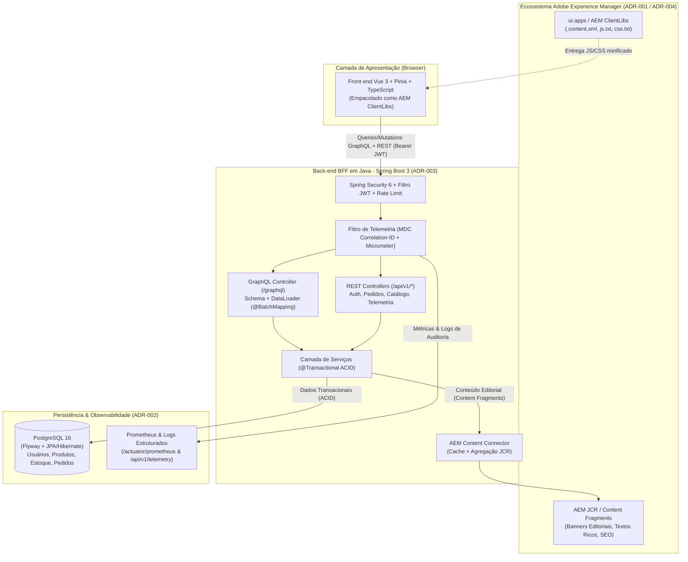

# Plano de Desenvolvimento — E-Commerce Enterprise (Vue.js + AEM + Java Spring Boot + GraphQL + PostgreSQL)

## 1. Objetivo Executivo
Desenvolver uma aplicação de **E-Commerce Enterprise** completa, containerizada e pronta para apresentação técnica em entrevista com gestor, atendendo integralmente aos requisitos descritos em `docs/introducao.md` e às decisões arquiteturais documentadas nas ADRs (`ADR-001` a `ADR-004`).

---

## 2. Mapeamento de Requisitos & ADRs

| Requisito / ADR | Solução Técnica Implementada |
| :--- | :--- |
| **Front-end (Vue.js + AEM) & ADR-004** | Aplicação **Vue 3 + TypeScript + Vite + Pinia** estruturada como componentes compatíveis com **AEM (Adobe Experience Manager)**. Inclui pipeline customizado (`aem-clientlib-generator.mjs`) que converte o bundle compilado do Vite em **AEM ClientLibs** (`ui.apps/.../clientlibs/clientlib-site` com `.content.xml`, `js.txt` e `css.txt`). |
| **Back-end (Java) & Consumo GraphQL + API (ADR-003)** | **Java 21/22 + Spring Boot 3.3**, expondo camada BFF em **Spring for GraphQL** (`/graphql`) + **API REST** (`/api/v1/*`). Implementa `@BatchMapping` (**DataLoader**) para eliminar o problema de **N+1 queries** e agrega dados transacionais do PostgreSQL com conteúdos editoriais vindos do AEM Content Services (JCR Mock/Service). |
| **Banco de Dados PostgreSQL (ADR-002)** | **PostgreSQL 16** gerenciado via **Spring Data JPA / Hibernate** e versionado com **Flyway** (`V1__init_schema.sql`, `V2__seed_data.sql`), garantindo propriedades **ACID** (`@Transactional`) em operações de checkout, controle de estoque otimista (`@Version`) e histórico do usuário. |
| **Containerização (ADR-001)** | **Docker & Docker Compose** orquestrando: PostgreSQL, AEM Headless/JCR Content Mock, Back-end Java (com Maven Wrapper embutido), Front-end Vue/Nginx e stack de Telemetria (Prometheus + Grafana). |
| **Segurança & Melhores Práticas** | **Spring Security 6 + JWT (JSON Web Token)** stateless, senhas com hash **BCrypt**, controle de acesso baseado em papéis (**RBAC**: `ROLE_CUSTOMER`, `ROLE_ADMIN`), validação de entrada (`Jakarta Validation`), proteção contra SQL Injection, cabeçalhos seguros (CSP, X-Frame-Options) e filtro de Rate Limiting. |
| **Telemetria & Monitoramento de Logs** | Filtro de **Correlation ID (`X-Correlation-ID`)** propagado via **MDC (Mapped Diagnostic Context)** nos logs estruturados, métricas **Micrometer + Prometheus** (`/actuator/prometheus`), interceptador de telemetria GraphQL/REST com armazenamento de logs e métricas em tempo real consultáveis no painel de observabilidade. |
| **Testes Unitários, E2E e Carga (500 e 5.000 VUs)** | **Unitários Back-end**: JUnit 5 + Mockito + Spring Boot Test.<br>**Unitários Front-end**: Vitest + Vue Test Utils.<br>**End-to-End (E2E)**: Playwright testando o fluxo completo.<br>**Testes de Carga**: Scripts **k6** (`load-tests/k6-500-5000-users.js`) + executor de carga assíncrono em Node.js (`load-tests/run-load-test.mjs`) capaz de simular e gerar relatório real para **500 e 5.000 usuários simultâneos**. |
| **Git, Fluxograma e Explicação do Código** | Versionamento Git com commits semânticos, documentação com **Fluxogramas Mermaid** (`docs/FLUXOGRAMA_ARQUITETURA.md`) e **Guia Completo de Entendimento do Código para a Entrevista** (`docs/GUIA_ENTREVISTA_ENTENDIMENTO_CODIGO.md`). |

---

## 3. Fluxograma Arquitetural da Aplicação



---

## 4. Estrutura de Diretórios do Projeto

```text
ecommerce-project/
├── docs/
│   ├── introducao.md
│   ├── ADRS/
│   │   ├── ADR001.md .. ADR004.md
│   ├── PLANS/
│   │   └── PLANO_DESENVOLVIMENTO.md
│   ├── FLUXOGRAMA_ARQUITETURA.md
│   └── GUIA_ENTREVISTA_ENTENDIMENTO_CODIGO.md
├── backend/                          # Back-end Java (Spring Boot 3 + GraphQL + REST + JPA + Security + Actuator)
│   ├── Dockerfile
│   ├── mvnw / mvnw.cmd
│   ├── pom.xml
│   └── src/
│       ├── main/
│       │   ├── java/com/ecommerce/
│       │   │   ├── config/           # Security, GraphQL DataLoader, CORS, Cache
│       │   │   ├── controller/       # GraphQLController, RestApiController, AuthController, TelemetryController
│       │   │   ├── domain/           # Entidades JPA (User, Product, Order, OrderItem, NavigationAudit)
│       │   │   ├── dto/              # Records de Request/Response e Modelos AEM
│       │   │   ├── repository/       # Spring Data JPA Repositories
│       │   │   ├── security/         # JwtService, JwtAuthenticationFilter, RateLimitFilter
│       │   │   ├── service/          # ProductService, OrderService, AemContentService, TelemetryService
│       │   │   └── telemetry/        # CorrelationIdFilter, StructuredLogAppender
│       │   └── resources/
│       │       ├── application.yml
│       │       ├── db/migration/     # Flyway SQL Migrations (PostgreSQL)
│       │       └── graphql/          # schema.graphqls
│       └── test/                     # Testes Unitários e de Integração (JUnit 5 + Mockito + MockMvc)
├── ui.frontend/                      # Aplicação Front-end em Vue 3 + Vite + TypeScript + Vitest + Playwright
│   ├── Dockerfile
│   ├── package.json
│   ├── vite.config.ts
│   ├── scripts/
│   │   └── aem-clientlib-generator.mjs  # ADR-004: Converte dist do Vite em AEM ClientLibs
│   ├── src/
│   │   ├── api/                      # Cliente Híbrido GraphQL + REST com Interceptor JWT e Telemetria
│   │   ├── components/               # Componentes AEM + E-commerce (HeroBanner, ProductGrid, Cart, TelemetryPanel)
│   │   ├── stores/                   # Pinia Stores (auth, catalog, cart, telemetry)
│   │   └── App.vue
│   ├── tests/
│   │   ├── unit/                     # Testes Unitários Vitest
│   │   └── e2e/                      # Testes End-to-End Playwright
├── ui.apps/                          # Pacote AEM ClientLibs gerado automaticamente (ADR-004)
│   └── src/main/content/jcr_root/apps/ecommerce/clientlibs/clientlib-site/
│       ├── .content.xml
│       ├── css.txt
│       └── js.txt
├── load-tests/                       # Testes de Carga para 500 e 5.000 usuários simultâneos
│   ├── k6-ecommerce-load.js          # Script oficial Grafana k6 (cenários 500 VUs e 5000 VUs)
│   ├── run-load-test.mjs             # Benchmark runner Node.js para validar 500 e 5000 usuários localmente
│   └── RELATORIO_TESTE_CARGA.md      # Resultados consolidados dos testes de 500 e 5.000 usuários
└── docker-compose.yml                # Orquestração completa do ecossistema (ADR-001)
```

---

## 5. Etapas de Execução (Roadmap)

### Fase 1: Inicialização Git & Planejamento
1. Inicializar repositório Git (`git init`) e configurar `.gitignore`.
2. Documentar o Plano de Desenvolvimento em `docs/PLANS/PLANO_DESENVOLVIMENTO.md`.

### Fase 2: Back-end Java (Spring Boot 3 + PostgreSQL + GraphQL + REST + Segurança + Telemetria)
1. Configurar o projeto Maven com **Maven Wrapper (`mvnw`)** para build reprodutível local e em Docker.
2. Criar migrações **Flyway** (`V1__init_schema.sql` e `V2__seed_data.sql`) com tabelas `users`, `products`, `orders`, `order_items` e `navigation_logs`.
3. Implementar integração com **AEM Content Fragments** (`AemContentService`) que retorna dados editoriais do JCR (banners promocionais, descrições ricas de autoria, badges editoriais e metadados SEO) e faz o merge com os dados transacionais do PostgreSQL.
4. Implementar o schema **GraphQL** (`schema.graphqls`) e resolvers com **`@BatchMapping`** (padrão **DataLoader** citado na `ADR-003` para resolver o problema de N+1 queries ao buscar conteúdos AEM e avaliações por lote de produtos).
5. Implementar endpoints **REST** (`/api/v1/auth/*`, `/api/v1/products/*`, `/api/v1/orders/*`, `/api/v1/telemetry/*`) para demonstrar o consumo duplo (GraphQL + API REST).
6. Configurar **Spring Security 6 + JWT + RBAC + Rate Limiting** e **Telemetria (MDC Correlation ID + Micrometer Prometheus + Log Collector em memória)**.
7. Criar e executar **Testes Unitários e de Integração** em Java com JUnit 5 e Mockito.

### Fase 3: Front-end Vue 3 + Pipeline AEM ClientLibs (ADR-004)
1. Criar aplicação **Vue 3 + TypeScript + Vite + Pinia** em `ui.frontend/`.
2. Desenvolver interface moderna de E-Commerce com:
   - **Banner Editorial AEM** (renderizando Content Fragments do JCR).
   - **Catálogo de Produtos** consumido via **GraphQL** (combinando dados do AEM JCR + Preço/Estoque do PostgreSQL em uma única query!).
   - **Carrinho de Compras e Checkout Transacional ACID** via GraphQL Mutation / REST API protegida por **JWT**.
   - **Painel Interativo de Telemetria & Inspector GraphQL/AEM** na própria interface (excelente para demonstração ao vivo na entrevista!).
3. Criar o script `scripts/aem-clientlib-generator.mjs` que lê o `manifest.json`/assets do Vite e gera automaticamente a estrutura XML do AEM em `ui.apps/src/main/content/jcr_root/apps/ecommerce/clientlibs/clientlib-site/`.
4. Criar e executar **Testes Unitários de Front-end** (Vitest) e **Testes End-to-End** (Playwright).

### Fase 4: Testes de Carga (500 e 5.000 Usuários Simultâneos) & Dockerização (ADR-001)
1. Construir `Dockerfile` multi-stage para Back-end e Front-end e configurar o `docker-compose.yml` com PostgreSQL, AEM Mock, Back-end Java, Front-end e Prometheus.
2. Criar a suíte de **Testes de Carga** para **500 e 5.000 usuários simultâneos**, executá-la contra a aplicação rodando e registrar as métricas reais de latência (p50, p95, p99), throughput (req/s) e estabilidade sob estresse.

### Fase 5: Fluxograma & Guia de Entendimento para a Entrevista
1. Criar `docs/FLUXOGRAMA_ARQUITETURA.md` com diagramas detalhados de cada fluxo (Arquitetura Geral, Resolução GraphQL + DataLoader, Checkout ACID, Pipeline Vite -> AEM ClientLibs).
2. Criar `docs/GUIA_ENTREVISTA_ENTENDIMENTO_CODIGO.md` explicando de forma didática cada módulo, classe, padrão de projeto e como responder às perguntas mais comuns do gestor sobre a aplicação.
3. Realizar commits organizados no Git.
